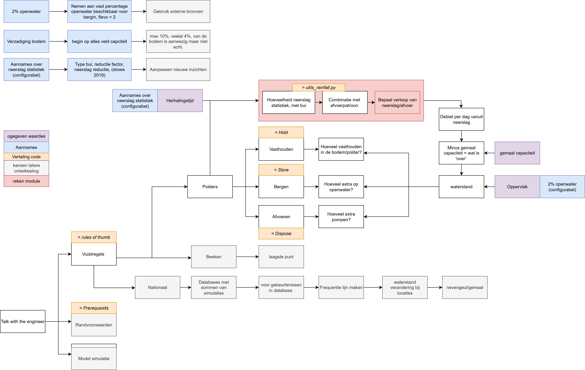

# Talk with the engineer

This repository contains the Talk with the engineer package: a **world model of a Dutch
polder** — a state, a set of measures, an exogenous forcing and a transition — with the
water-management rules of thumb (vuistregels) as the questions you can ask it. MCP and
FastAPI are one interface onto it, not the thing itself. Developed by HKV and published
under the GNU GPL-3 license.

<details>
<summary>Project structure</summary>

## Project structure

Three layers, and the dependency runs one way only:

    interface  ->  epistemics  ->  core

The test for which layer something belongs to is the question *what survives if the
interface disappears?* `tests/test_core_boundary.py` enforces the direction with an AST
check, in the same form that `test_kern_properties.py` uses to keep the array backend
switchable.

### `core/` — the world model

The state (`state.py`, `connection.py`, `system.py`, `soil.py`), the measures
(`actions.py`), the exogenous forcing (`exogenous/`) and the statistics it is drawn from
(`stats/`), the transition (`transition.py`) and its inverse (`inverse.py`), the network
and allocation passes, the package search (`package.py`), and the cost side (`cost.py`,
`reward.py`).

Knows nothing about MCP, about output language, or about the tools' input models. It does
use pydantic — `PolderState` and `Action` are frozen models — but never a tool schema.

### `epistemics/` — what you may believe about an answer

Assumed defaults (`assumptions.py`), computable spread (`uncertainty.py`), structural
caveats (`caveats.py`) and the posts that have a price but no amount (`priceless.py`).

Its own layer rather than part of the core, because it talks about answers and not about
water; and not part of the interface, because a notebook calling the core directly wants
the same caveats.

### `interface/` — the view

Input and output schemas (`schemas/`), the twelve thin tool wrappers (`tools/`), the
explanatory sentences (`descriptions.py`) and the MCP/FastAPI endpoints (`mcp/`).
Replaceable: a second protocol goes next to `mcp/`, not into the core.

### `utils/`

Generic helpers that have nothing to do with water — logging, docstring generation, the
webservice and database plumbing.

Design plans and findings reports for this structure live in `docs/plannen/`; the layout
above is `PLAN_CORE_EPISTEMICS_INTERFACE.md`.
</details>

## Developing

Here are a couple quick useful things to know when using this repo.

### Pre-commit

This repo uses pre-commit, make sure you run `pixi run pre-commit` before you commit anything.

### GitHub workflows

In the folder `.github/workflows` there are three workflows (tests, pre-commit and docs) which run automatically when submitting a pull request.

### Plans and build notes

Design plans, build notes and findings reports live in `docs/plannen/`. They document
why the tools work the way they do; they are not rendered into the documentation site.

## Getting started

To manage the environment we use [Pixi](https://pixi.sh).

<details>
<summary>windows</summary>

```powershell
iwr -useb https://pixi.sh/install.ps1 | iex
```

</details>

<details>
<summary>Linux/Mac</summary>

```bash
curl -fsSL https://pixi.sh/install.sh | bash
```

</details>

#### installing

With the `pixi` command install the python environment:

```bash
 cd talk-with-the-engineer
 pixi install
```

The `pixi.lock` file loads the correct packages and downloads to the `.pixi` folder.

For questions about how to use this package contact `hoek@hkv.nl` or `haasnoot@hkv.nl`.

## Architecture


