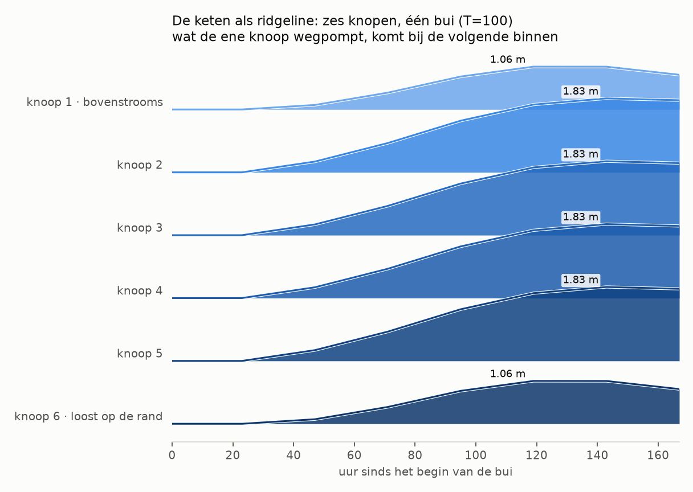
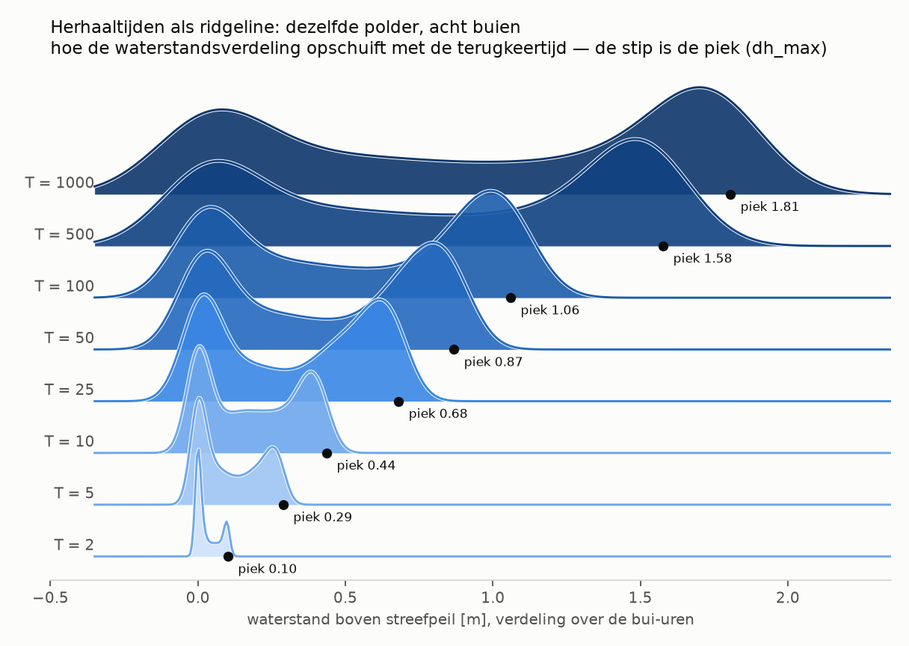
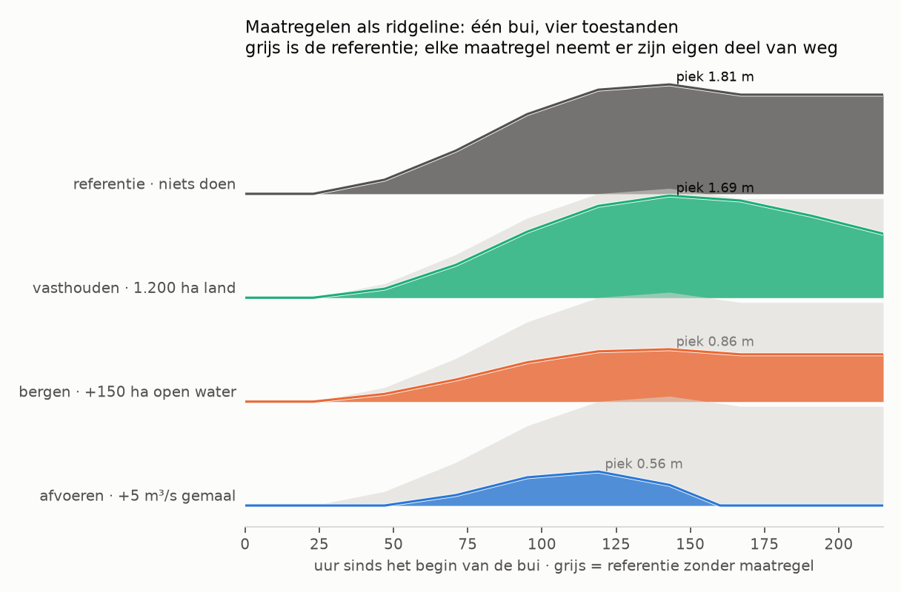
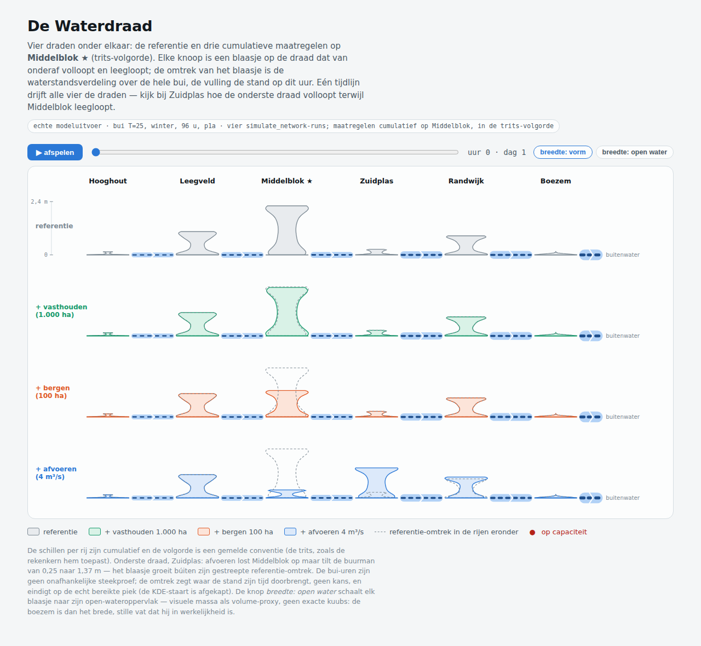
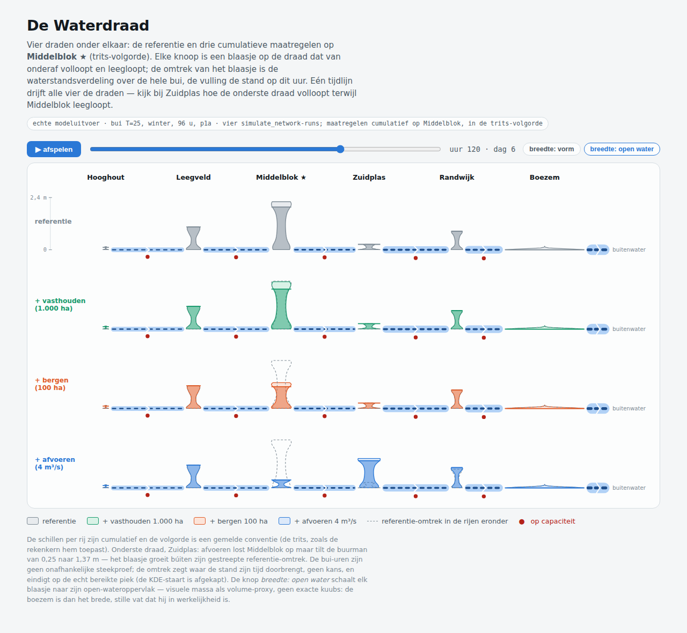
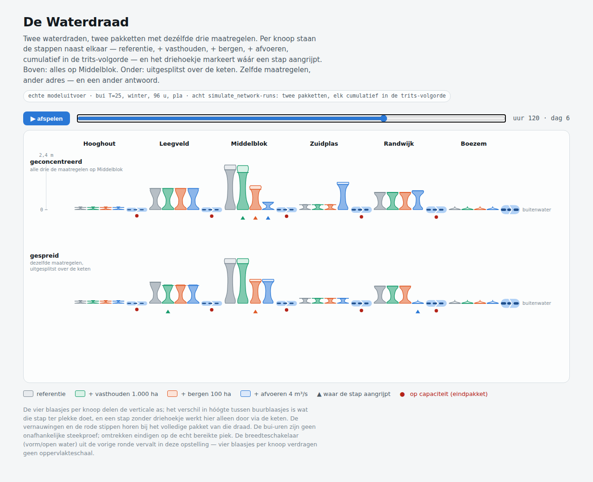
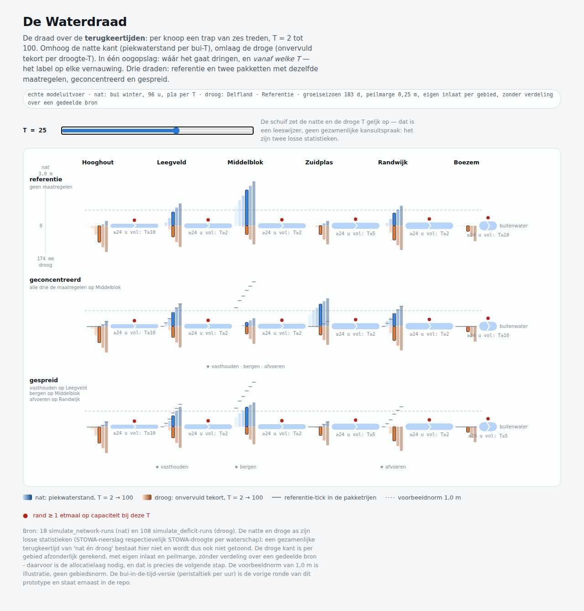
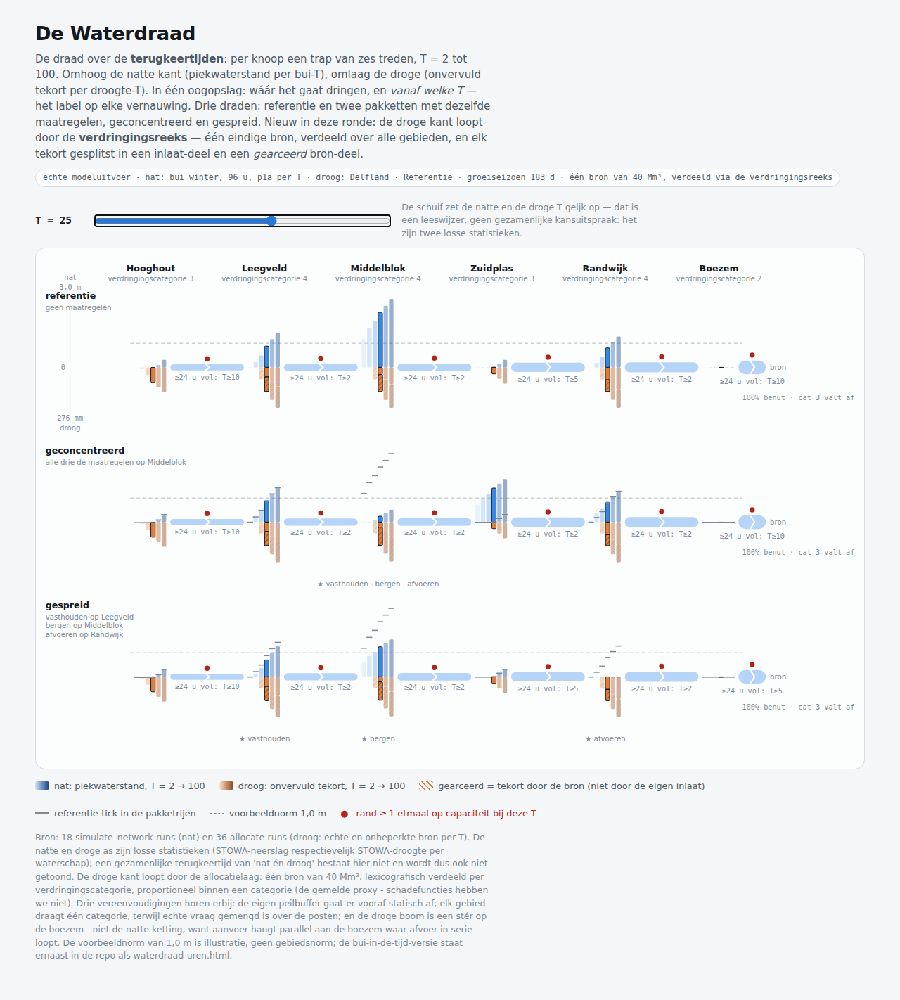

# Notitie — de toestand als ridgeline: een compacte vorm voor PolderState en SystemState

Vastgelegd om verder te verkennen, nog geen plan. De vraag: bestaat er één compacte
visualisatievorm die de onderdelen van een `PolderState` of `SystemState` naast elkaar
zet zonder dashboard te worden? De kandidaat is de **categorical ridgeline** (gestapelde
dichtheden of gestapelde reeksen met bewuste overlap), zie
[drhill.io/blog/ridgelineplots](https://drhill.io/blog/ridgelineplots/) en het
ggridges-gedachtegoed daarachter.

De drie varianten hieronder draaien op échte modeluitvoer (`simulate` en
`simulate_network` op de referentiepolder), via `scripts/verkenning_ridgelines.py`.

## Variant 1 — SystemState: de keten, elke knoop een rij

Zes knopen in een kralenketting, oplopende capaciteit stroomafwaarts, de rand met het
boezemgemaal. Elke rij is de waterstandsreeks van één knoop; de rijen overlappen bewust
zodat de cascade als één beeld leest. **Bevinding uit de eerste poging:** met gelijke
capaciteiten klemmen de middenknopen alle vier op exact dezelfde stand — de ridgeline
maakt in één oogopslag zichtbaar dat de keten tegen één klem loopt, wat in een tabel
vier keer hetzelfde getal was geweest. Dat is precies het soort systeemuitspraak
(vergelijk `CascadeOutput`: de bindende beperking en waar hij zit) waar deze vorm goed
in is.

## Variant 2 — herhaaltijden: de verdeling schuift op met T

Dezelfde polder, acht buien (T=2 t/m 1000), per rij de verdeling van de uurlijkse
waterstanden. De tweetoppigheid is echt: de linkerbult is het begin van de bui, de
rechterbult het plateau waar het gemaal het niet meer bijhoudt. Dit is de **ruwe
grondstof van de overschrijdingsfrequentielijn** uit `VERKENNING_BUDGETVRAAG.md` §6 —
dezelfde veeg, als verdeling getoond in plaats van als lijn.

## Variant 3 — PolderState: maatregelen tegen hun referentie

Eén bui, vier toestanden: de referentie en drie maatregelen, elk met de referentie als
grijs spook erachter. De vorm laat het karakter van elke maatregel zien — vasthouden
vertraagt, bergen dempt, afvoeren pompt de staart weg — en dat is de visuele
tegenhanger van de bijdrage-per-maatregel uit de frequentielijn-discussie.

## Ontwerpkeuzes tot nu toe

* **De ordening van de rijen draagt de betekenis**: stroomafwaarts (variant 1),
  oplopende T (variant 2), of maatregel-identiteit (variant 3). Nooit alfabetisch.
* **Kleur volgt het werk**: sequentieel één blauw, licht → donker, voor geordende rijen
  (diepte, T); categorische kleuren in vaste volgorde alleen waar de rij een identiteit
  is (maatregelen).
* **Overlap is een instelling, geen ongeluk** — het ggridges-`scale`-idee; hier ~0,85
  van de rijafstand voor reeksen en ~1,5 voor dichtheden.
* De uren van een bui zijn **geen onafhankelijke steekproef** (autocorrelatie); de
  dichtheden van variant 2 zijn dus een beeld van "waar de toestand zijn tijd
  doorbrengt", geen kansverdeling. Dat hoort in elk bijschrift.

## Open vragen voor de volgende ronde

1. Welke onderdelen van de toestand verdragen één gedeelde as? Waterstand wel;
   voorraad, marge en kosten hebben elk hun eigen eenheid — een ridgeline per grootheid,
   of normaliseren tegen de eigen norm?
2. De MGA-koppeling: de romp uit `VERKENNING_BUDGETVRAAG.md` §5 als ridgeline — per
   maatregel de verdeling van zijn maatvoering over de near-optimale pakketten.
3. Renderkanaal: als los beeld (zoals hier), of interactief via MCP Apps bij een
   toolresultaat (spec 2026-07-28). Eerst moet de vorm zelf overtuigen.
4. Donkere modus en het huisstijlpalet: dit is het referentiepalet uit de verkenning,
   niet de HKV-huisstijl.

---

## Ronde 2 — de waterdraad: van rijen naar draden

De ridgeline-varianten hierboven splitsen op de y-as uit. De tweede ronde kantelt dat
naar het beeld waar de zoektocht eigenlijk om draaide: de topologie als **één
horizontaal vat** — elke knoop een verwijding (de waterstandsverdeling als rechtopstaand
blaasje), elke verbinding een vernauwing met zijn capaciteit als dikte, elk gemaal een
klep, en de bui die doortrekt als peristaltiek. Interactief (SVG/JS, geen matplotlib):
het prototype staat in `waterdraad.html` naast deze notitie, de data komt uit
`scripts/verkenning_waterdraad.py` (vier echte `simulate_network`-runs: referentie plus
cumulatief vasthouden, bergen en afvoeren op Middelblok).

### Wat deze ronde leerde

1. **De vulling hoort verticaal.** De eerste versie vulde de violin langs zijn
   waarde-as, dus zijwaarts — cognitief verkeerd om voor water. De blaasjes staan nu
   rechtop (hoogte = waterstand, breedte = dichtheid) en lopen bij het afspelen van
   onderaf vol en leeg.
2. **Toestanden zijn losse draden onder elkaar, geen schillen in één draad.** Een
   eerdere versie stapelde de voor/na-verdelingen als schillen in dezelfde verwijding;
   dat werd onleesbaar zodra een maatregel een verdeling liet gróeien. Vier complete
   draden onder elkaar (referentie + drie maatregelstappen) brengen de
   ridgeline-gedachte terug — rijen = toestanden, kolommen = knopen — en één tijdlijn
   drijft ze synchroon.
3. **De referentie-omtrek als gestreept spook in elke rij eronder** maakt voor/na per
   blaasje leesbaar, en maakt afwenteling tot één beeld: afvoeren op Middelblok laat
   het eigen blaasje in zijn spook krimpen (2,21 naar 0,37 m) terwijl het blaasje van
   Zuidplas er b&uacute;iten groeit (0,25 naar 1,37 m; zijn rand van 108 naar 144 u op
   capaciteit).
4. **Breedte is een keuze met twee eerlijke standen.** Vormmodus (gelijke breedte)
   vergelijkt verdelingsvormen; gewichtsmodus (breedte evenredig met het
   open-wateroppervlak) leest als visuele massa — de boezem wordt het brede stille vat
   dat hij is, Hooghout het smalle. Het is een proxy en geen kuubs, en zo staat het ook
   op de pagina.
5. **KDE-hygiëne**: de omtrek is afgekapt op het echt bereikte bereik van de reeks;
   zonder die afkap tekende de staart een haarlijn boven de werkelijke piek.

### Ronde 3 — één pakket is weer één draad, de stappen als cluster per knoop

De vier draden van ronde 2 gaven elke maatregelstap een eigen draad, en dat verspilt de
rij-as aan iets dat geen alternatief is. Ronde 3 draait het om (voorstel Mattijn): de
stappen staan als **x-offset-cluster naast elkaar per knoop** — referentie,
+ vasthouden, + bergen, + afvoeren, vier smalle blaasjes — zodat één pakket weer één
waterdraad is. De rij-as komt daarmee vrij voor waar hij hoort: **wezenlijk
verschillende pakketten**. De eerste vergelijking die dat oplevert is meteen de
leerzaamste die deze keten heeft:

* **geconcentreerd** (alles op Middelblok): Middelblok van 2,21 naar 0,37 m, maar
  Zuidplas van 0,25 naar 1,37 m — de afwenteling zit nu ín het cluster (het blauwe
  blaasje torent boven zijn drie buren uit) — en vier randen staan 144 u op capaciteit;
* **gespreid** (vasthouden op Leegveld, bergen op Middelblok, afvoeren op Randwijk):
  iedereen een beetje geholpen, niemand verzopen — Zuidplas blijft 0,25 m, Randwijk
  gaat zelfs naar 0 — en de keten staat korter op capaciteit (120/108/120 u in plaats
  van drie keer 144). De prijs: Middelblok blijft op 1,20 m staan in plaats van 0,37.

Zelfde drie maatregelen, ander adres, ander antwoord — de trap-van-ambitie-les van
`kaart-is-een-keuze.svg`, maar nu gerekend in plaats van verzonnen. De driehoekjes
markeren per draad waar een stap aangrijpt; een blaasje dat verandert zónder driehoekje
verandert via de keten. De breedteschakelaar (vorm/open water) uit ronde 2 vervalt in
deze opstelling: vier blaasjes per knoop verdragen geen oppervlakteschaal, dus die twee
lezingen sluiten elkaar voorlopig uit — een echte afruil om te onthouden.

### Open voor ronde 4

* de rijen vullen met de **near-optimale pakketten uit de MGA-verkenning**
  (VERKENNING_BUDGETVRAAG.md §5) in plaats van met de hand gekozen alternatieven —
  dan is dit beeld de presentatielaag van de vlakvraag;
* de droge kant als tweede helft van het vat (onder de draad), zodra de
  voorraden-doorrekening per knoop beschikbaar is;
* vertakkende topologieën — dit is een ketting, een boom vraagt splitsende draden;
* het buiprofiel als klein verloop bij de tijdlijn, zodat de peristaltiek aan zijn
  aanleiding gekoppeld is;
* normalisatie per blaasje versus over de hele draad, en de vorm/gewicht-afruil
  hierboven — beide blijven gemelde keuzes.

---

## Ronde 4 — de draad over de terugkeertijden

De praktijkvraag die deze ronde afdwong: het gaat nooit over één terugkeertijd — je
wilt in één beeld zien **bij welke T het gaat dringen**, en dat voor wateroverlast én
watertekort tegelijk. Drie ankers uit de literatuur (augustus 2026) zetten de vorm:

* de **EP-curve** (prestatie tegen overschrijdingskans) is de standaardvorm voor de
  ene as — Mattijns frequentielijn uit issue #37, hier als trap van zes treden per
  knoop;
* de **adaptation-pathways-school** levert het woord voor "waar het gaat dringen": het
  *knikpunt* — de stressorwaarde waarbij het systeem zijn norm of capaciteit verliest.
  Op de draad is dat per vernauwing af te lezen: "≥ 24 u vol vanaf T=…";
* de **copula-literatuur** over compound droogte-overstromingsrisico geeft de grens:
  een gezamenlijke terugkeertijd van "nat én droog" vergt afhankelijkheidsmodellering
  die twee losse STOWA-producten niet dragen. De T-schuif zet beide assen daarom wel
  géljk maar de pagina meldt expliciet: leeswijzer, geen gezamenlijke kansuitspraak.

De vorm: per knoop een trap van zes treden (T = 2 … 100), **nat omhoog** (piek per
bui-T, blauwe reeks) en **droog omlaag** (onvervuld tekort per droogte-T, warme reeks,
eigen mm-as); drie draden (referentie, geconcentreerd, gespreid); referentie-ticks in
de pakketrijen; de tijdas van de vorige rondes is vervangen door een T-schuif. Het
prototype staat in `waterdraad.html`, de uur-versie (peristaltiek) ernaast als
`waterdraad-uren.html`; de data komt uit `verkenning_waterdraad_terugkeertijden.py`
(18 netwerk- en 108 deficit-runs).

### Wat deze ronde leerde

1. **De droge kant is pas informatief mét inlaat en peilmarge.** Zonder die twee is
   het tekort in elk gebied exact het neerslagtekort — een dode kolom. Met een eigen
   inlaat per gebied krijgt elk gebied zijn droge knikpunt (Hooghout komt al bij T=5
   tekort, de Boezem pas bij T=25).
2. **De peilmarge veranderde ook het natte knikpunt-criterium.** Met 0,25 m marge
   draait élk gemaal ook bij T=2 een paar uur op capaciteit (de marge wordt
   leeggemalen), dus "ooit vol" is te binair; het criterium is nu minstens een etmaal,
   en dat staat als conventie op de pagina.
3. **Natte maatregelen doen droog vrijwel niets** — alleen bergen scheelt millimeters
   (groter open water = grotere buffer). Dat is geen tekortkoming van het beeld maar
   van het pakket, en precies wat de twee assen naast elkaar moeten laten zien.
4. De droge kant is hier **per gebied afzonderlijk** gerekend, zonder verdeling over
   een gedeelde bron; de allocatielaag (verdringingsreeks) is de ontbrekende koppeling
   en staat bovenaan voor ronde 5.

### Open voor ronde 5

* de droge kant door `allocate` laten lopen (gedeelde bron, verdringingsreeks) in
  plaats van per gebied een eigen oneindige inlaatbron te veronderstellen;
* echte gebiedsnormen in plaats van de voorbeeldnorm van 1,0 m, en de tekortnorm
  aan de droge kant;
* de rijen vullen met near-optimale MGA-pakketten (agenda ronde 3, blijft staan);
* een gezamenlijke nat-droog-kansuitspraak alléén als er afhankelijkheidsdata komt
  (copula op gekoppelde reeksen) — tot die tijd blijft de schuif een leeswijzer.

---

## Ronde 5 — de droge kant door de verdringingsreeks

De agenda-kop van ronde 4 is uitgevoerd: de droge kant loopt niet langer per gebied
tegen een eigen oneindige bron, maar door `allocate` — één eindige bron (40 Mm³ over
het seizoen), lexicografisch verdeeld per verdringingscategorie, proportioneel binnen
een categorie. Twee allocate-runs per T (echte en onbeperkte bron) splitsen elk tekort
in een **inlaat-deel** en een **bron-deel**; dat laatste is gearceerd — de gestapelde
dichtheid uit de eerdere rondes keert terug als gestapelde oorzaak.

### Wat deze ronde leerde

1. **De droge boom is niet de natte ketting.** De eerste opzet hergebruikte de
   afvoertopologie voor de aanvoer, en toen moest alle vraag door de boezem-inlaat van
   de keten: die ene inlaat werd de flessenhals voor het hele stelsel en de bron werd
   nooit meer dan 40% benut. Aanvoer hangt parallel als stér aan de boezem waar afvoer
   in serie loopt — de waterdraad heeft dus twee topologieën in één beeld, en dat is
   geen visualisatieprobleem maar een systeemeigenschap.
2. **De verdringingsreeks is nu zichtbaar als gedrag**: vanaf T=10 is de bron vol
   benut, houdt categorie 2 (de boezem) nul tekort, blijft categorie 3 beperkt en
   draagt categorie 4 de bron-tekorten — de schillen van `allocate` als beeld, met per
   draad de meebewegende status ("100% benut · cat 3 valt af").
3. **Het bron/inlaat-onderscheid verschilt per gebied** en is precies het advies-
   onderscheid uit de allocatietool: Hooghout komt tekort door zijn eigen inlaat
   (meer aanvoeren helpt daar niet), Middelblok vooral door de bron (daar helpt alleen
   meer water of een andere verdeling).

### Gemelde vereenvoudigingen

De eigen peilbuffer gaat er vooraf statisch af (de echte tijdsdynamiek van buffer én
verdeling samen is een kernvraag, geen visualisatievraag); elk gebied draagt één
verdringingscategorie terwijl echte vraag gemengd is over de posten (de
vraagposten-data uit PR #61 is de weg naar beter); en het bronvolume van 40 Mm³ is een
gekozen demo-waarde.

### Open voor ronde 6

* de gemengde vraag per gebied (drie posten per knoop via `demand_posts.json`) in
  plaats van één categorie per gebied;
* echte gebiedsnormen op beide assen; de voorbeeldnorm van 1,0 m blijft illustratie;
* de rijen vullen met near-optimale MGA-pakketten (staat sinds ronde 3);
* de tijdsdynamische koppeling van buffer, inlaat en verdeling — een kernvraag die
  eerst een eigen plan verdient.
